# Coordinating Continuum remediation: initial design review

Development candidate: `aws-agents-for-devsecops` `1.2.0-dev.2`.
This is an additive plugin capability proposed for maintainer feedback, not a
released AWS product or a promise of unattended remediation.

## The problem this addresses

Individually valid security fixes can interact. An authorization check may need a
field that a privacy fix removes; both security tests can pass while legitimate
requests fail. Reviewing findings independently does not establish that their
patches work together.

Continuum supplies security findings, service issue relationships, available
proof and proposed changes. The coding agent inspects the application and authors
the combined change. The plugin retains every finding's disposition, makes
interaction assumptions explicit, runs protected regressions and legitimate-use
controls, and binds review to the exact tested source.

[Continuum issues](https://docs.aws.amazon.com/continuum/latest/userguide/cv-viewing-issues.html)
already expose contributing findings. A service issue is distinct from a locally
reviewed root-cause group or a compatible change unit. Available proof may be
source analysis; the service documentation does not promise an executable proof
for every issue.

```mermaid
flowchart LR
  C[Continuum findings and service issues] --> I[Read-only intake]
  I --> T[Complete triage and evidence]
  R[Application source and conventions] --> T
  T --> P[Reviewed groups and interactions]
  P --> A[Coding agent authors changes]
  A --> V[Per-issue and combined tests]
  V -->|failure retained| A
  V -->|passing source| H[Independent combined review]
  H --> L[Local change package and source map]
  L -. future publication gate .-> PR[Hosted pull request]
  PR -. optional .-> D[DevOps release readiness]
  D -. recommendations to same owner .-> A
  PR -. human approval .-> M[Merge and reassess]
```



Solid arrows describe the local coordination path. Dashed arrows include
integration work beyond this candidate. The diagram contains fixed explanatory
text, not executable content from findings.

## How this maps to the proposed experience

| Proposed experience | Candidate boundary |
| --- | --- |
| Continuum identifies security issues; the coding agent understands the app | Read-only service intake preserves original judgments. The agent reviews applicability and records any disagreement separately. |
| Setup learns and confirms how the application runs | The agent inspects the repository and authors an explicit application contract. Automatic repository onboarding and automatic discovery of every required command are not implemented. |
| Related findings become coherent, compatible changes | Complete triage is separate from execution selection. Reviewed root causes, dependencies and pairwise interactions govern selected work. |
| Each issue has a failing-before/passing-after test | Required for each selected local issue, alongside valid-behavior checks. Retained/deferred findings are not labeled fixed. |
| Developers see assets, issues, changes and merge order | Source evidence and attributed relationship review remain separate. Uncertain relationships must remain visible; ordering is advice, not merge authority. |
| Pull requests explain fixes and their effects | The candidate prepares a local review artifact. Hosted PR creation/update, UI screenshot collection and provider policy enforcement remain delivery work. |
| Plugin owns patch writing while active | The candidate never publishes. Unknown or disabled service patch policy does not establish an atomic cross-service writer lock. |
| Trust grows toward bounded automatic merging | Human review remains the intended first release policy. Automatic merge and policy graduation are future design work. |
| Codex first, other coding agents later | Installed Codex behavior has been exercised. Other-client manifests do not establish behavioral parity. |

## What the core experiment establishes

A controlled invoice application has two distinct security issues: cross-tenant
access and disclosure of private processor data. Each individual fix passes its
own security regression and shared application checks. In the deliberately broken
composition, projection removes the tenant identity before authorization.
Security regressions pass but legitimate tenant requests fail.

The installed Codex workflow diagnosed that interaction, authorized the complete
domain record before producing the public response, and passed the combined
checks without changing the protected tests. An independent reviewer inspected
the complete source diff and bound execution evidence.

That is a concrete demonstration of the coordination benefit. It is not a
measurement of model reliability, proof that all findings in an environment were
fixed, or evidence that every application is covered by these tests.

The separate service integration test read a complete selected scan containing
134 finding records and 131 service issues. The installed plugin replayed the
historical triage losslessly, retaining 114 advisory root-cause labels and 456
source anchors. None was newly selected or fixed by that replay. A source-linked
map exercised six citations and kept its unknown deployment relationship visible.
Raw scan data and account information are excluded from this package.

## Validation of this candidate

Validation on 30 October 2026 UTC passed 107 runtime tests with zero skips,
including real Docker execution, plus all six toolkit tooling tests. Manifest,
specification, client parity, skill metadata, Markdown, Ruff, static example,
diff and secret checks passed. The available toolkit build constituent commands
were run directly because `mise` was unavailable.

The evaluated whole-plugin bundle contained 70 files; delivered bytes and modes
matched the installed Codex copy. The actual agent evaluation used Codex 0.165.0
with `global.openai.gpt-6-astra`. Its first process wrote the interaction repair
and then lost model credentials before testing. A fresh process inspected and
preserved that change, then passed all eight combined Docker checks covering
eleven protected test methods. Failed process and application attempts were
retained. Unit/valid and integration/smoke checks reuse test classes, so these
are not eight independent test suites.

The final synthetic execution is identified by:

```text
run:    226b9223f0994e5b72985df08fa804a4c191d5989682b17ae7d9dfe888958091
source: 600d720c82721a341a2ead7602905b7891b2170310c0ad90b1792b3319976997
diff:   36ece555e743a56897f86595c3e73bdfd53a4263ffbdac362456de4594772bd8
```

Use the [portable overlap demo](../examples/overlap-demo/README.md) to reproduce
the interaction without access to the private service scan. A hash identifies
the recorded evidence; it does not independently attest the reviewer or service.

## Why include DevOps Agent later

The local plugin gives a developer repository-specific control over triage,
changes and regression tests. The team owns the runtime, test images, review
conventions, evidence handling and maintenance.

[DevOps release readiness](https://docs.aws.amazon.com/devopsagent/latest/userguide/release-management-release-readiness-code-review.html)
adds a managed review point for dependency risks, standards and access-control
correctness, with optional managed build/run/test verification on connected
repositories. Its findings should return to the same change owner, followed by
new combined checks when source changes.

Release management is documented as
[preview](https://docs.aws.amazon.com/devopsagent/latest/userguide/working-with-devops-agent.html).
Automatic PR/MR review triggers apply to private repositories; public repositories
can request reviews through chat or supported coding integrations. This candidate
does not demonstrate managed fix-authoring parity, a connected repository release,
or replacement of repository-required CI.

## Maintainer feedback requested

1. Does coordinated remediation belong in this plugin, and who owns its service
   adapter and runtime compatibility contract?
2. Is the distinction between service issues, local root causes and compatible
   change units appropriate? When should interacting groups share one PR?
3. Which setup and source-binding evidence is required before execution?
4. What publication protocol establishes one change owner across in-flight
   service patches, existing PRs, retries and crashes?
5. Which ordinary application should be the next pilot, with required CI, human
   merge and reassessment as its exit criteria?

The repository's current [contribution policy](../../../CONTRIBUTING.md) accepts
bug reports and feature requests but does not accept external code contributions.
Use this packet for the appropriate owner discussion before upstream submission.
No issue, PR, release or promotion is implied by preparing it.

## Before a production pilot

- Agree and support the Continuum transport/API contract. The adapter's tested
  behavior is an observed authenticated integration, not a public SDK stability
  guarantee.
- Implement idempotent hosted publication and reconcile existing/in-flight
  writers without weakening local execution gates.
- Bind actual required CI and review policy to the published commit, then
  validate human merge and reassessment of that source.
- Exercise an ordinary application, UI changes when applicable, denied/missing
  repository access, interrupted publication and recovery.
- Assign maintenance, test-image updates, data retention and incident ownership;
  validate each additional coding client independently.
